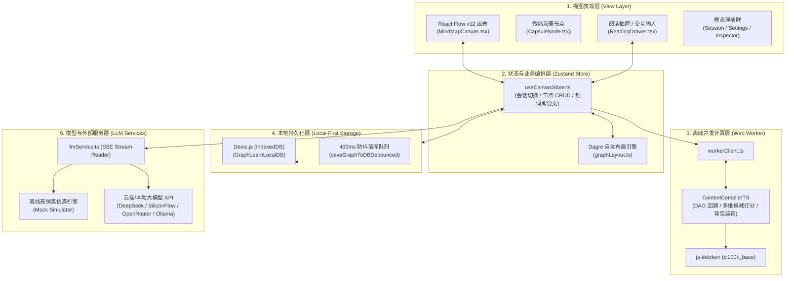
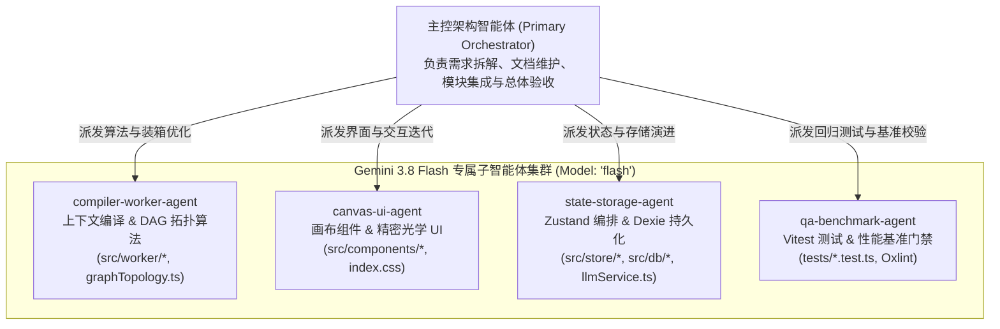

# GraphLearn 项目交接与系统全景文档 (Project Handover Documentation)

> **版本**：v1.2.0 (Multi-Format Export, Undo/Redo Engine, Hybrid Scoring & Optimized Build)  
> **更新时间**：2026-11-03  
> **文档定位**：面向新接手工程师、架构师、核心维护者及 **AI 研发智能体（Agents）** 的全景交接手册，涵盖项目定位、痛点解析、系统架构、代码文件全景、已交付成果、未来规划及 **Gemini 3.8 Flash 子智能体协同研发规范**。

---

## 1. 项目内容简述 (Executive Summary)

### 1.1 什么是 GraphLearn？
**GraphLearn** 是一款面向复杂技术攻坚、系统级推演与深度结构化学习的 **AI 原生思维导图画布系统（AI-Native Mind Map Canvas）**。

传统的 AI 对话工具（如 ChatGPT、Claude、DeepSeek 官方 Web UI）基于**单向线性时间线（Linear Chat Stream）**。当面对复杂的系统设计（如 Linux 虚拟内存架构、分布式 Raft 共识、微服务 RPC 框架推演）时，线性流会面临严重的**上下文语义漂移、多分支方案无法并存、证伪方案污染后续推演、超长文本消耗 Token 预算**等核心瓶颈。

GraphLearn 颠覆了这一范式：
* **以 DAG 图拓扑取代单向线性流**：用户可以在无限二维画布上随时派生假设分支、进行 A/B 方案对比、合并不同前置分支（Multi-parent Merge），实现真正的树状与网状思考。
* **本地优先（Local-First）与极速零依赖**：基于纯前端全栈 TypeScript 架构，无需任何 Python 运行时或中间层后端，打开静态网页即可离线使用，数据通过 Dexie.js (IndexedDB) 毫秒级保存在用户浏览器本地。
* **双模态沉浸交互**：画布宏观态以微缩胶囊卡片（`240px × 76px`）展示核心结论与状态，微观态通过右侧抽屉滑出完整 Markdown 与代码；支持划词即分支（Highlight-to-Branch）、实时 X-Ray 光线追踪与精准溯源角标跳转。
* **认知证据阶梯案卷规范（Epistemic Hierarchy Prompt Spec）**：单轮文档化案卷编译，根目标强行锁定、已证伪方案转为反向红线避坑约束、已验证节点无损摘要跨分支检索。

---

## 2. 希望解决的问题与项目初衷 (Problems to Solve & Motivation)

GraphLearn 的诞生旨在彻底解决技术专家在使用 LLM 进行系统化研发推演时的五大痛点：

| 痛点场景 | 传统线性聊天 (Chat UI) 的缺陷 | GraphLearn 的创新解决方案 |
| :--- | :--- | :--- |
| **1. 上下文语义漂移与目标稀释** | 随着提问轮数增加（如追问到第 10 轮局部细节），初始的核心大目标被挤出注意力窗口，AI 开始泛泛而谈。 | **根目标容器 `<root_goal>` 绝对锚定**：无论分支深入多少层，根节点大目标始终以最高权重独立锁定在 Prompt 顶部，彻底杜绝语义漂移（通过 TC-01 验证）。 |
| **2. 方案探索与证伪避坑** | 当某条技术路线被证实不可行（如“软件模拟页表性能过差”）时，传统对话只能口头提醒，AI 在后续回答中依然频繁混淆并反复提出错误方案。 | **状态机门控与反向红线约束**：将节点标记为 🔴 `DEPRECATED`，编译引擎自动将其转化为 `<negative_constraints>` 注入 Prompt，命令模型必须绕开废案（通过 TC-03 验证）。 |
| **3. Token 预算浪费与长文膨胀** | 闲聊、调优、格式对齐和几千行代码堆积在 Context 中，迅速消耗几万甚至十几万 Token 预算，导致调用昂贵且延迟飙升。 | **拓扑距离衰减 + 结构化无损知识卡（KnowledgeArtifact）**：非直系节点自动降级为 50 字核心结论、宏定义与函数签名，亚毫秒级背包贪心装箱控制在 Token 预算内。 |
| **4. 局部技术规范定点挂载** | 无法针对特定问题注入专门的资料（如特定模块的内核源码切片），全局 RAG 召回经常错配或污染其他分支。 | **外部资料局部挂载（Scoped Reference Chunks）**：支持将 Markdown/文本文件直接挂载至指定节点，并以 Tier 1 绝对权威来源（`<tier1_authoritative_sources>`）注入 Prompt。 |
| **5. 复杂架构的多前置分支汇聚 (Merge)** | 技术设计往往需要结合多个模块（例如：结合“TLB 快表”与“内核页表锁”设计缺页中断处理流程），传统对话无法引用两条并行线索。 | **DAG 多父节点汇聚融合**：允许单个节点连接多个父节点，编译引擎自动并行向上溯源并合并上下文（通过 TC-06 验证）。 |

---

## 3. 系统架构与关键技术机制 (System Architecture)

### 3.1 系统分层拓扑与数据流图



### 3.2 核心架构原则与设计亮点

1. **主线程 60 FPS 绝对平滑**：
   * 画布只渲染轻量级的 `CapsuleNode`（固定 `240px × 76px`，仅含标题、状态微图标与 50 字结论），长文本 Markdown 与代码高亮完全卸载至 `ReadingDrawer`。
   * 图遍历、DAG 祖先拓扑计算、打分衰减与 Token 装箱算法全部由 `contextCompiler.worker.ts` 在独立后台线程中执行。**200 个复杂节点编译耗时仅 0.505ms**，彻底杜绝主线程掉帧。
2. **纯前端本地优先 (Local-First Multi-Session)**：
   * 采用 Dexie.js (IndexedDB) 管理本地存储，支持创建多个独立会话，高频输入/拖拽事件执行 400ms 防抖持久化，关闭页面即存，刷新秒级还原。
   * 支持一键导出 `.canvas.json` 工程档案与 Markdown 结构化复盘报告。
3. **触感工坊与精密光学设计规范 (Tactile Studio & Optical Glass)**：
   * 摒弃低质 AI 产品的蓝紫霓虹发光与大面积闪烁特效；
   * 采用物理光学毛玻璃、1px 细微边缘折射高光、温润宣纸暖白（Light）与矿物炭黑（Dark）双主题无缝切换；
   * 节点探索、验证、证伪状态通过“几何矢量微图标 + 边框线型 + 色彩锚点”三重冗余设计，一目了然。

---

## 4. 源码文件清单与详细用途 (File Map & Roles)

### 4.1 根目录配置与工程基建

| 路径 | 语言/格式 | 核心用途与维护说明 |
| :--- | :--- | :--- |
| [package.json](file:///e:/Project/AntigravityIDEUsed/graphlearn/package.json) | JSON | 项目依赖与脚本配置。包含 React 19、`@xyflow/react`、`@dagrejs/dagre`、`dexie`、`js-tiktoken`、`zustand` 等。 |
| [vite.config.ts](file:///e:/Project/AntigravityIDEUsed/graphlearn/vite.config.ts) | TypeScript | Vite 8 构建配置，配置了 Tailwind CSS v4 插件与 React 插件，集成了开发环境跨域代理。 |
| [tsconfig.json](file:///e:/Project/AntigravityIDEUsed/graphlearn/tsconfig.json) | JSON | TypeScript 全局工程引用配置。 |
| [tsconfig.app.json](file:///e:/Project/AntigravityIDEUsed/graphlearn/tsconfig.app.json) | JSON | 客户端应用的 TypeScript 编译选项（严格模式、ESNext、DOM 类型等）。 |
| [.oxlintrc.json](file:///e:/Project/AntigravityIDEUsed/graphlearn/.oxlintrc.json) | JSON | Oxlint 超快代码检查配置文件。 |
| [index.html](file:///e:/Project/AntigravityIDEUsed/graphlearn/index.html) | HTML | 单页应用宿主 HTML，配置了全屏视口、中文字体与 `gl_theme` 初始化脚本。 |
| [AGENTS.md](file:///e:/Project/AntigravityIDEUsed/graphlearn/AGENTS.md) | Markdown | 工作区级 AI 智能体研发与子智能体编排规则（Workspace Rule），授权自由调用 Gemini 3.8 Flash 模型与自定义子智能体并行研发。 |
| [README.md](file:///e:/Project/AntigravityIDEUsed/graphlearn/README.md) | Markdown | 面向开发者的项目核心特性介绍、快速启动指令与验收用例矩阵。 |

---

### 4.2 `src/` 核心应用源码

#### 1. 入口与样式
* **[src/main.tsx](file:///e:/Project/AntigravityIDEUsed/graphlearn/src/main.tsx)**：React 19 挂载入口，挂载 `<App />`。
* **[src/App.tsx](file:///e:/Project/AntigravityIDEUsed/graphlearn/src/App.tsx)**：主容器组件。统一挂载画布、工具栏、阅读抽屉与各类模态对话框，注册全局快捷键（`Esc` 关闭抽屉/弹窗、`Delete` 删节点、`Ctrl+L` 整理布局、`Ctrl+Shift+X` 开启 X-Ray 预览）。
* **[src/index.css](file:///e:/Project/AntigravityIDEUsed/graphlearn/src/index.css)**：全局样式表与设计令牌。定义了明暗双主题 CSS 变量（`--bg-canvas`、`--glass-bg`、`--surface-*`、`--accent-*`），定义了微缩胶囊呼吸灯动效与光线追踪样式。

#### 2. 类型定义 (`src/types/`)
* **[src/types/canvas.ts](file:///e:/Project/AntigravityIDEUsed/graphlearn/src/types/canvas.ts)**：系统领域核心类型模型。
  * `NodeCategory`：节点分类（`root_goal`、`core_conclusion`、`code_impl`、`concept_qa`、`chitchat_debug`）。
  * `EpistemicStatus`：认知状态（`exploring` 探索草稿、`verified` 已验证、`deprecated` 已证伪废案）。
  * `ManualState`：人工干预状态（`auto` 自动打分、`pinned` 强制置顶、`ignored` 手动忽略）。
  * `KnowledgeArtifact`：无损结构化知识卡（包含 50 字核心结论、宏定义/硬核不变量、函数签名）。
  * `ReferenceChunk`：挂载的外部资料切片实体。
  * `CanvasNodeData` / `CanvasGraph`：画布节点与整图实体结构。
  * `CompilationResult` / `CompileOptions`：编译引擎出入参及 X-Ray 调试状态结构。
  * `LLMSettings` / `LLMProviderId`：模型服务配置结构。

#### 3. 状态管理 (`src/store/`)
* **[src/store/canvasStore.ts](file:///e:/Project/AntigravityIDEUsed/graphlearn/src/store/canvasStore.ts)**：全局响应式状态中心（基于 Zustand）。
  * 涵盖图谱初始化、节点增删改查、多父节点连线/解绑；
  * 实现节点智能删除（reparent 接续 / cascade 级联删除 / isolate 孤立）；
  * 调度 Web Worker 编译与 X-Ray 光线追踪高亮；
  * 驱动流式大模型生成与写后异步知识卡提取（`artifactExtractor`）；
  * 多会话管理动作（新建、切换、重命名、复制副本、删除、导入/导出）。

#### 4. 本地数据库 (`src/db/`)
* **[src/db/database.ts](file:///e:/Project/AntigravityIDEUsed/graphlearn/src/db/database.ts)**：IndexedDB 本地数据库管理（基于 Dexie.js）。
  * 建立 `GraphLearnLocalDB` 数据库，声明 `graphs` 表与 `settings` 表；
  * 提供 `saveGraphToDBDebounced`（400ms 防抖保存，防止拖拽高频 I/O 卡顿）；
  * 提供 `flushSaveGraphToDB`（切换会话或卸载前强制落库）；
  * 管理会话元数据列表与最后活跃会话记录。

#### 5. Web Worker 编译引擎 (`src/worker/`)
* **[src/worker/contextCompiler.ts](file:///e:/Project/AntigravityIDEUsed/graphlearn/src/worker/contextCompiler.ts)**：上下文编译核心算法。
  * 多源 DAG 祖先 BFS 回溯，计算 Hop 距离；
  * 多维加权衰减打分算法（分类权重 × 祖先距离衰减因子）；
  * 背包贪心 Token 装箱，保障不超过预算上限；
  * 输出 `<root_goal>`、`<tier1_authoritative_sources>`、`<tier2_canvas_context>` 与 `<negative_constraints>` 结构化案卷。
* **[src/worker/contextCompiler.worker.ts](file:///e:/Project/AntigravityIDEUsed/graphlearn/src/worker/contextCompiler.worker.ts)**：Web Worker 后台线程入口，监听主线程 `compile` 消息并回发结果。
* **[src/worker/workerClient.ts](file:///e:/Project/AntigravityIDEUsed/graphlearn/src/worker/workerClient.ts)**：主线程封装的 Worker 异步客户端，支持 Promise 异步调用与错误降级。

#### 6. 核心服务与算法 (`src/services/`)
* **[src/services/llmService.ts](file:///e:/Project/AntigravityIDEUsed/graphlearn/src/services/llmService.ts)**：流式大模型通信服务。
  * 封装 OpenAI 兼容协议的标准 SSE 流读取器；
  * 内置无需配置的离线高保真仿真引擎（Mock Simulator），自动生成带 C 语言宏、内核结构体签名与 `[Ref: node_id]` 引用角标的高质量推演；
  * 支持浏览器安全模式代理转发，解决部分云端 API 的跨域限制。
* **[src/services/providerConfigs.ts](file:///e:/Project/AntigravityIDEUsed/graphlearn/src/services/providerConfigs.ts)**：预置主流模型提供商配置（DeepSeek、SiliconFlow 硅基流动、OpenRouter、本地 Ollama、OpenAI、Claude 等）。
* **[src/services/artifactExtractor.ts](file:///e:/Project/AntigravityIDEUsed/graphlearn/src/services/artifactExtractor.ts)**：写后知识卡异步提取服务。从长文回答中解析 50 字精炼结论、宏定义/不变量以及函数代码签名。
* **[src/services/graphLayout.ts](file:///e:/Project/AntigravityIDEUsed/graphlearn/src/services/graphLayout.ts)**：基于 `@dagrejs/dagre` 的有向无环图自动分层排列算法。
* **[src/services/graphTopology.ts](file:///e:/Project/AntigravityIDEUsed/graphlearn/src/services/graphTopology.ts)**：有向无环图 (DAG) 拓扑关系校验引擎。实现无环检测（BFS 环路阻断）、两节点连接合法性校验、父子节点关系查询与前置/后置候选过滤。
* **[src/services/tokenEstimator.ts](file:///e:/Project/AntigravityIDEUsed/graphlearn/src/services/tokenEstimator.ts)**：Token 计数器。集成 `js-tiktoken`（cl100k_base 编码），并提供轻量级正则预估快速通道。

#### 7. 视图组件群 (`src/components/`)
* **画布组件 (`src/components/Canvas/`)**：
  * **[MindMapCanvas.tsx](file:///e:/Project/AntigravityIDEUsed/graphlearn/src/components/Canvas/MindMapCanvas.tsx)**：基于 React Flow 的主画布。自定义阶梯连线、实时防环连线校验（`isValidConnection`）、视口居中平滑缩放、点击与拖拽手势。
  * **[CapsuleNode.tsx](file:///e:/Project/AntigravityIDEUsed/graphlearn/src/components/Canvas/CapsuleNode.tsx)**：微缩胶囊节点组件。渲染状态标识（⚪ 探索 / 🟢 验证 / 🔴 废弃）、置顶 Pin 图标、快捷连线入口、舒适触控连线锚点与 50 字结论。
  * **[InteractiveMindMapEdge.tsx](file:///e:/Project/AntigravityIDEUsed/graphlearn/src/components/Canvas/InteractiveMindMapEdge.tsx)**：可交互平滑连线组件。渲染悬停微胶囊断开按钮（`×`）、方向提示与 X-Ray 动态流光。
  * **[Toolbar.tsx](file:///e:/Project/AntigravityIDEUsed/graphlearn/src/components/Canvas/Toolbar.tsx)**：顶部光学毛玻璃工具栏。集成会话管理入口、自动排版、新建节点、全局拓扑连线、案卷透视、模型配置、明暗主题切换与导入导出。
* **抽屉与交互组件 (`src/components/Drawer/`)**：
  * **[ReadingDrawer.tsx](file:///e:/Project/AntigravityIDEUsed/graphlearn/src/components/Drawer/ReadingDrawer.tsx)**：微观态阅读抽屉（宽度 `42vw`）。内置「拓扑关联」专栏，支持前置依赖与后置派生列表展示、一键断开、定位及添加关联。
  * **[FloatingBubbleMenu.tsx](file:///e:/Project/AntigravityIDEUsed/graphlearn/src/components/Drawer/FloatingBubbleMenu.tsx)**：划词即分支浮动气泡菜单。支持选中文本一键触发 `[🌱 追问此概念]`、`[💡 举例]`、`[✏️ 自定义]`。
  * **[CitationPill.tsx](file:///e:/Project/AntigravityIDEUsed/graphlearn/src/components/Drawer/CitationPill.tsx)**：引用角标微组件。将 `[Ref: node_id]` 转化为徽章，点击调用 React Flow `setCenter` 600ms 平滑居中并触发 2 秒蓝色脉冲呼吸灯。
  * **[MountedDocsSection.tsx](file:///e:/Project/AntigravityIDEUsed/graphlearn/src/components/Drawer/MountedDocsSection.tsx)**：局部外部参考资料挂载卡片。支持添加、预览与解绑参考资料切片。
* **模态对话框群 (`src/components/Modals/`)**：
  * **[SessionManagerModal.tsx](file:///e:/Project/AntigravityIDEUsed/graphlearn/src/components/Modals/SessionManagerModal.tsx)**：多会话管理面板。支持搜索过滤、会话一键切换、新建空白/模板会话、重命名、一键克隆副本与安全删除。
  * **[ConnectNodesModal.tsx](file:///e:/Project/AntigravityIDEUsed/graphlearn/src/components/Modals/ConnectNodesModal.tsx)**：节点拓扑连线弹窗。支持搜索筛选起点与终点、方向调换、实时 DAG 成环与有效性校验、一键建立关联。
  * **[CreateNodeModal.tsx](file:///e:/Project/AntigravityIDEUsed/graphlearn/src/components/Modals/CreateNodeModal.tsx)**：新建节点弹窗。支持指定节点标题、多父节点（Multi-parent Merge）汇聚、分类及问题。
  * **[DeleteNodeModal.tsx](file:///e:/Project/AntigravityIDEUsed/graphlearn/src/components/Modals/DeleteNodeModal.tsx)**：智能删除确认弹窗。提供“接续（子节点移交至父级）”、“级联删除（递归清理子树）”与“孤立节点”三种策略。
  * **[PromptInspectorModal.tsx](file:///e:/Project/AntigravityIDEUsed/graphlearn/src/components/Modals/PromptInspectorModal.tsx)**：案卷透视器。实时显示 Web Worker 编译后的 XML 案卷文本、耗时及 Token 占用统计。
  * **[SettingsModal.tsx](file:///e:/Project/AntigravityIDEUsed/graphlearn/src/components/Modals/SettingsModal.tsx)**：模型服务配置面板。选择提供商预设、配置 API Key、Base URL、自定义模型名及跨域代理开关。

#### 8. 演示拓扑数据集 (`src/data/`)
* **[src/data/demoGraph.ts](file:///e:/Project/AntigravityIDEUsed/graphlearn/src/data/demoGraph.ts)**：包含两个经过严密推演的高质量演示拓扑：
  1. `INITIAL_DEMO_GRAPH`：**Linux 虚拟内存实战图谱**（包含根目标、置顶权威规范、已证伪扁平页表废案、TLB 快表、缺页中断多父汇聚等）；
  2. `RPC_DEMO_GRAPH`：**高并发分布式 RPC 框架推演图谱**；
  3. `createBlankGraph`：快速初始化全新空白图谱的工厂方法。

---

### 4.3 `tests/` 自动化测试套件

| 测试文件 | 覆盖范围与验证项 | 执行指令 |
| :--- | :--- | :--- |
| [tests/contextCompiler.test.ts](file:///e:/Project/AntigravityIDEUsed/graphlearn/tests/contextCompiler.test.ts) | **核心验收标准测试与性能基准**：<br/>• **TC-01**：主干目标防稀释验证（连续追问 10 轮根目标锁定）；<br/>• **TC-03**：草稿态隔离与证伪避坑（草稿隔离，deprecated 注入反向红线）；<br/>• **TC-04**：外部资料绝对服从（Tier 1 注入）；<br/>• **TC-06**：多父节点 DAG 汇聚融合；<br/>• **性能基准**：200 个节点复杂拓扑图编译耗时实测 0.505ms（硬约束 <5ms）。 | `npm test` |
| [tests/nodeConnection.test.ts](file:///e:/Project/AntigravityIDEUsed/graphlearn/tests/nodeConnection.test.ts) | **节点连线与 DAG 防环验证**：<br/>• 自环检测与防范；<br/>• 重复连接检测；<br/>• 直接与多跳深层环路拦截；<br/>• 多父节点合法汇聚融合；<br/>• 断开与建立连线拓扑状态持久化。 | `npm test` |
| [tests/nodeDeletion.test.ts](file:///e:/Project/AntigravityIDEUsed/graphlearn/tests/nodeDeletion.test.ts) | 验证三种删除策略（reparent 模式正确更新子节点 parentIds，cascade 模式递归删除整颗子树）。 | `npm test` |
| [tests/sessionManager.test.ts](file:///e:/Project/AntigravityIDEUsed/graphlearn/tests/sessionManager.test.ts) | 验证多会话隔离创建、深拷贝克隆、唯一 graphId 与数据独立性。 | `npm test` |

---

### 4.4 `md/` 历史规划与设计规范文档库

* [md/01_PROJECT_PLAN.md](file:///e:/Project/AntigravityIDEUsed/graphlearn/md/01_PROJECT_PLAN.md)：项目规划与 4 阶段研发里程碑（算法验证 -> 画布 MVP -> 编译器与工作流 -> 端侧 RAG 与桌面化）及子智能体迭代机制。
* [md/02_ENGINEERING_REQUIREMENTS.md](file:///e:/Project/AntigravityIDEUsed/graphlearn/md/02_ENGINEERING_REQUIREMENTS.md)：工程架构规范、核心 TypeScript Schema、NFR 非功能性指标与子智能体并发研发准则。
* [md/03_DESIGN_SPECIFICATIONS.md](file:///e:/Project/AntigravityIDEUsed/graphlearn/md/03_DESIGN_SPECIFICATIONS.md)：界面交互规格、双模态胶囊/抽屉设计、节点拓扑连线规范与键盘热键规范。
* [md/04_ACCEPTANCE_CRITERIA.md](file:///e:/Project/AntigravityIDEUsed/graphlearn/md/04_ACCEPTANCE_CRITERIA.md)：验收测试用例详细说明（TC-01 ~ TC-06 验收准则）与子智能体验收清单。
* [md/DESIGN.md](file:///e:/Project/AntigravityIDEUsed/graphlearn/md/DESIGN.md)：「触感工坊与精密光学」前端视觉与交互设计规范（配色变量、阴影、微动画、响应式断点）。

---

## 5. 历史已完成的核心工作 (Completed Milestones)

系统已完成以下所有核心能力建设并已通过全部自动化测试验证：

1. **核心算法与编译器构建**：
   * 完成 `ContextCompilerTS`，实现 DAG 拓扑多源最短距离计算、多维衰减加权评分与背包贪心装箱；
   * 实现结构化 XML 案卷输出（`<root_goal>`、`<tier1_authoritative_sources>`、`<tier2_canvas_context>`、`<negative_constraints>`）；
   * 通过 Web Worker API 移出主线程，经基准测试 200 节点耗时 0.5ms。
2. **纯前端高性能画布与双模态界面**：
   * 基于 `@xyflow/react` 与 `@dagrejs/dagre` 实现无限缩放画布与一键整齐排版；
   * 宏观态 `CapsuleNode` 结合微观态 `ReadingDrawer` 抽屉，实现长文本与主画布的完美性能解耦；
   * 实现划词即分支（`FloatingBubbleMenu`），选中文本直接拉出新节点并开启流式推演。
3. **精准溯源与光线追踪**：
   * 实现 AI 回复中的 `[Ref: node_id]` 自动转化为交互 Pill 徽章，点击 600ms 平滑居中并触发 2 秒蓝色脉冲呼吸灯（满足 TC-05）；
   * 实现 X-Ray 实时光线追踪，实时将画布连线与节点呈现高亮流光或弱化虚化。
4. **多会话管理与本地优先持久化**：
   * 集成 Dexie.js (IndexedDB)，支持多会话隔离管理、会话复制、重命名、模板新建与搜索；
   * 实现 400ms 防抖自动保存与退出前即时 Flush 落库；
   * 支持一键导出/导入 `.canvas.json` 与生成 Markdown 技术复盘长文。
5. **多模型适配与离线高保真仿真引擎**：
   * 支持 DeepSeek、SiliconFlow（硅基流动）、OpenRouter、本地 Ollama 等主流厂商；
   * 内置无需配置、即开即用的离线高保真推演仿真器（Mock 模式），无需 API Key 即可体验完整流程。
6. **用户自主建立与管理节点联系能力 (User-Defined Node Connections & DAG Merging)**：
   * **画布交互式拖拽连线**：胶囊卡片提供舒适的左右锚点（Input / Output），拖拽中实时进行有向无环图（DAG）成环检测（`wouldCreateCycle`），动态阻断非法闭环；
   * **交互式连线与一键断开**：`InteractiveMindMapEdge` 在悬停/选中时浮现光学微胶囊控制钮，支持一键断开或通过键盘 `Delete` 解除关联；
   * **全局拓扑连线弹窗 (`ConnectNodesModal`)**：支持跨视口长距离节点搜索、方向一键调换、实时合法性检测与一键建立前置输入；
   * **阅读抽屉「拓扑关联」专栏**：微观态下全景展示节点的前置依赖与下游派生节点，提供一键画布平滑定位、解绑断开与添加新依赖；
   * **新建节点支持多父节点汇聚**：`CreateNodeModal` 支持标签化选择多个前置父节点，在派生新推演时直接融合多条思考线索。

7. **细粒度历史撤销重做栈 (Undo/Redo History Stack)**：
   * 在 `canvasStore.ts` 中维护双向快照队列（`historyPast` 与 `historyFuture`，上限 30 步）；
   * 在节点增删、连线建立与解绑、状态切换（探索/验证/证伪）、标题与结论原地修改等拓扑变动前自动推入快照；
   * 高频流式输出（`isStreaming`）过程严格隔离，绝不产生无用快照；
   * 工具栏新增 Undo/Redo 按钮，全局接入 `Ctrl+Z` / `Cmd+Z` 与 `Ctrl+Y` / `Ctrl+Shift+Z` 热键（智能绕过输入框内部撤销）；
   * 通过 `tests/undoRedo.test.ts` 8 项严密单元测试。
8. **多格式导出与知识资产流转 (Multi-Format Export & Glass Modal)**：
   * **Mermaid 流程图导出**：输出标准 `flowchart TD`，遵循触感工坊视觉规范高亮根节点、已验证节点（绿色）与已证伪节点（红色删除线），保留 DAG 多父汇聚拓扑；
   * **OPML 2.0 导图大纲**：递归构建标准 XML outline 树形结构，保留节点提问、核心结论与不变量元数据，完美兼容 MindNode、XMind、OmniOutliner；
   * **Markdown 架构复盘长文**：结构化生成根目标、推演脉络全景、知识卡精粹（宏定义与函数签名）、反向避坑指南与权威资料切片；
   * **`ExportModal` 光学毛玻璃弹窗**：支持代码实时等宽预览、一键复制（带 2s 触感状态反馈）与本地文件下载；
   * 通过 `tests/exportService.test.ts` 9 项完整单元测试。
9. **上下文编译混合重排 (Hybrid Scoring & Keyword Overlap Boosting)**：
   * 在 `contextCompiler.ts` 引入亚毫秒级内存分词与特征提取（`< 0.01ms`）；
   * 对当前问题与节点标题、知识卡核心结论、宏不变量及函数签名进行多维加权（动态提升 `1.1x ~ 1.35x`）；
   * 确保与当前问题高度相关的远端祖先知识卡在 Token 装箱中获得优先保留；
   * 200 节点 Benchmark 实测编译耗时 **0.71ms**，稳健严守 `< 5ms` 门禁约束。
10. **生产构建分块与打包体积极限优化 (Rollup Code Splitting)**：
    * 在 `vite.config.ts` 中配置 `manualChunks` 将 `tiktoken`、`react`、`xyflow`、`dexie` 等三方依赖拆分独立 vendor 包；
    * 主应用入口文件由 **6.48MB 骤降至 190kB**（Gzip 后仅 49kB），彻底消除 Rollup 大包警告；
    * Oxlint 静态检查实现 **0 Warning, 0 Error**（通过抽离惰性初始化彻底根除 React Cascading Render 告警）。

---

## 6. 后续演进方向与待解决问题 (Future Roadmap & Open Issues)

对于新接手的工程师或 AI 智能体，建议优先关注以下技术演进点与待解决问题：

### 6.1 待实现的高价值特性 (High-Priority Backlog)

1. **端侧轻量化向量检索 (Local In-Browser Embedding)**：
   * *当前现状*：目前编译打分依赖 DAG 拓扑距离、节点分类权重衰减与混合关键词重排（Hybrid Scoring）。
   * *演进方向*：通过 `@huggingface/transformers` 在浏览器端借助 WebAssembly/WebGPU 加载小型开源模型（如 `bge-small-zh-v1.5`，约 40MB），对挂载资料及历史节点生成向量，结合余弦相似度进行端侧全量语义重排。
2. **桌面原生应用封装 (Tauri 2.0 Integration)**：
   * *当前现状*：目前为标准 Web SPA。
   * *演进方向*：引入 Tauri 2.0 (Rust) 封装，生成针对 Windows / macOS / Linux 的极小桌面安装包（<15MB 安装包、<80MB 内存占用），并利用 Rust 本地文件系统能力实现本地文件夹直读与本地大文件挂载。
3. **多人协同与实时同步 (CRDT / Yjs)**：
   * *演进方向*：如果后续需要支持多人团队头脑风暴与架构评审，可引入 Yjs 或 Automerge 等 CRDT 库，利用 WebRTC 或轻量 WebSocket 实现去中心化/中心化多人画布实时协作。

---

## 7. 快速上手与日常维护指引 (Developer Operations)

### 7.1 开发环境要求
* **Node.js**：>= 18.0.0（推荐 Node.js 20+）
* **包管理器**：npm 或 pnpm
* **浏览器推荐**：Chrome / Edge / Firefox 最新版本（需支持 Web Worker 与 IndexedDB）

### 7.2 常用开发指令

```bash
# 1. 安装项目依赖
npm install

# 2. 启动本地开发服务器 (支持 Vite 毫秒级 HMR)
npm run dev

# 3. 运行自动化测试套件 (包含核心算法、验收用例与性能基准)
npm test

# 4. 运行 Oxlint 超快代码检查
npm run lint

# 5. 执行 TypeScript 严格类型检查并打包生产产物
npm run build

# 6. 本地预览打包产物
npm run preview
```

### 7.3 常见业务维护场景操作指引

* **如何新增一个大模型服务商？**
  * 在 [src/types/canvas.ts](file:///e:/Project/AntigravityIDEUsed/graphlearn/src/types/canvas.ts) 的 `LLMProviderId` 联合类型中增加标识符；
  * 在 [src/services/providerConfigs.ts](file:///e:/Project/AntigravityIDEUsed/graphlearn/src/services/providerConfigs.ts) 的 `PROVIDER_DEFINITIONS` 对象中增加该提供商的 Base URL、推荐模型列表及说明。
* **如何调整 Prompt 案卷编译的权重与规则？**
  * 修改 [src/worker/contextCompiler.ts](file:///e:/Project/AntigravityIDEUsed/graphlearn/src/worker/contextCompiler.ts) 中的 `DEFAULT_CATEGORY_WEIGHTS`（分类初始权重）及祖先 Hop 衰减公式；
  * 修改后务必运行 `npm test`，确保未破坏已有的 TC-01 ~ TC-06 验收准则。
* **如何修改或增加预置的 Demo 画布？**
  * 编辑 [src/data/demoGraph.ts](file:///e:/Project/AntigravityIDEUsed/graphlearn/src/data/demoGraph.ts)，增加新的 `CanvasGraph` 结构并在 `SessionManagerModal.tsx` 或 `Toolbar.tsx` 中注册对应模板入口。

---

## 8. AI 智能体与子智能体协同研发指引 (AI Agent & Subagent Orchestration)

本项目原生适配 **多智能体协同开发范式**（详见根目录 [AGENTS.md](file:///e:/Project/AntigravityIDEUsed/graphlearn/AGENTS.md)）。在优化、重构与扩展 GraphLearn 时，主智能体被明确授权：
* **自由调用 Gemini 3.8 Flash 模型**（在 `invoke_subagent` 中指定 `Model: 'flash'` 或 `'flash_lite'`，兼顾极速响应与高质量代码生成）；
* **自行定义与派生子智能体**（通过 `define_subagent` 与 `invoke_subagent` 按模块拆解并并发执行任务）。

### 8.1 子智能体拓扑与分工架构



### 8.2 子智能体调度最佳实践

1. **按职责边界动态建组 (`define_subagent`)**：
   * 针对独立子系统（如 Web Worker 编译内核、React Flow 自定义节点/边、IndexedDB 存储层、自动化测试套件），分别定义具有明确 `SystemPrompt` 的子智能体。
   * 只读调研任务优先使用内置 `research` 子智能体（或设置 `EnableWriteTools: false`），代码编写与测试修复任务开启 `EnableWriteTools: true` 并配置 `Model: 'flash'`。
2. **文件写入作用域隔离 (File Scope Isolation)**：
   * 当同时并行唤醒多个写权限子智能体时，必须在各自 `Prompt` 中严格限定允许修改的文件列表，避免多智能体同时修改同一文件（如 `src/store/canvasStore.ts` 或 `src/types/canvas.ts`）。
   * 若涉及核心 Schema（`src/types/canvas.ts`）变更，应由主智能体或先行子智能体率先完成类型定稿，再并行派发下游组件与算法子智能体。
3. **响应式唤醒与零轮询 (Reactive Wakeup)**：
   * 调用 `invoke_subagent` 后，子智能体在独立会话上下文中后台运行，主智能体无需轮询状态；待子智能体完成汇报后，统一执行 `npm test`、`npm run lint` 与 `npm run build` 验收闭环。
4. **文档先行与同步更新**：
   * 任何架构变更、新增状态流转或 UI 规范演进，均需同步更新 `HANDOVER.md` 及 `md/` 目录下的指引性文档，确保指引文档始终作为智能体团队的唯一事实来源（Single Source of Truth）。
